<div align="center">


# TosmFi — Web

**Catat, pahami, dan kendalikan keuanganmu.**
Pencatat keuangan pribadi: dompet, budget, jadwal tagihan, investasi, laporan, dan pencatatan transaksi lewat chat AI — dalam satu dashboard.

[](https://tosm-fi.netlify.app)


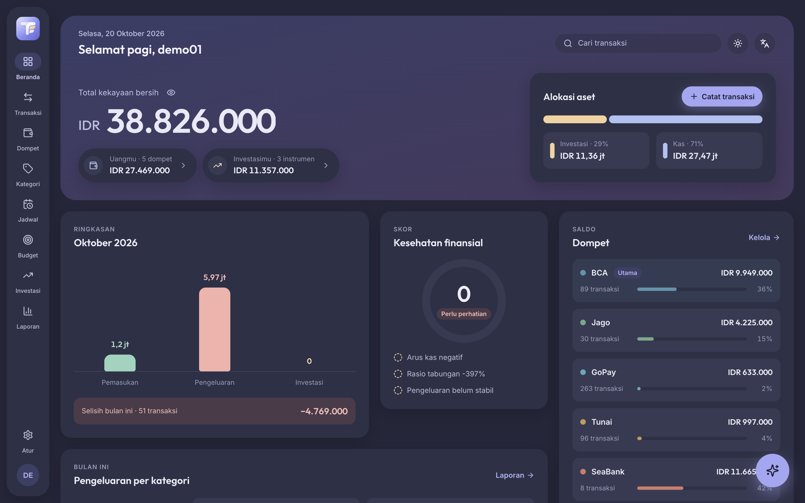

</div>

---

## 🔑 Akun demo

Coba langsung di **[tosm-fi.netlify.app](https://tosm-fi.netlify.app)**:

| Username | Password |
|---|---|
| `demo01` | `demo01` |

> Akun demo dipakai bersama. Silakan coba-coba, tapi jangan simpan data pribadi di sana. Reset Data, ganti username, dan ganti password dinonaktifkan untuk akun ini.

## 🧩 Ekosistem TosmFi

TosmFi terdiri dari tiga repo yang saling terhubung. Web dan aplikasi mobile memakai backend yang sama, jadi data yang dicatat di satu tempat langsung muncul di tempat lain.

| Repo | Peran | Stack | Link |
|---|---|---|---|
| **[tosm-fi](https://github.com/riantosm/tosm-fi)** ← kamu di sini | Web app (PWA) | React 19 · Vite · Tailwind | [tosm-fi.netlify.app](https://tosm-fi.netlify.app) |
| [tosm-fi-app](https://github.com/riantosm/tosm-fi-app) | Aplikasi mobile Android & iOS | React Native 0.87 | [Cara build](https://github.com/riantosm/tosm-fi-app#-menjalankan--build) |
| [tosm-fi-be](https://github.com/riantosm/tosm-fi-be) | REST API + AI (Catat Cepat) | Express · MongoDB · Gemini | [tosm-fi-be.vercel.app](https://tosm-fi-be.vercel.app) |

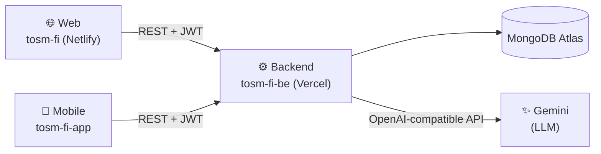

## 📸 Screenshot

<table>
  <tr>
    <td width="50%">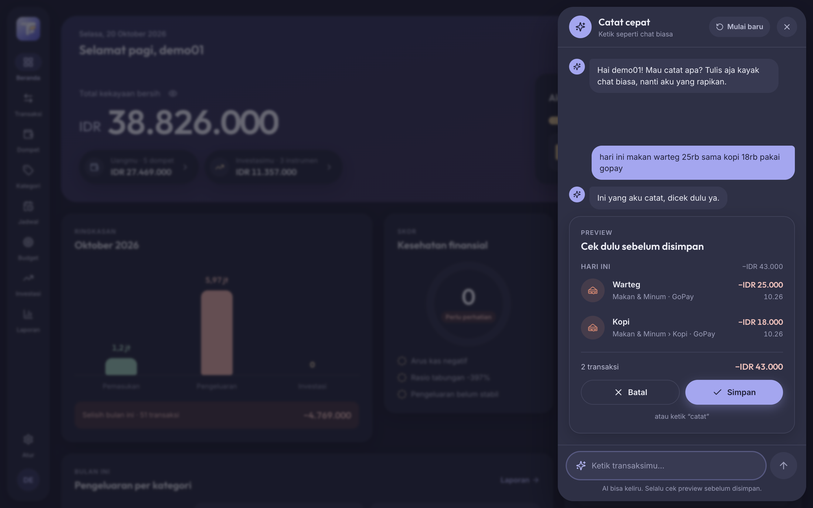<br/><b>Catat Cepat (AI)</b> — ketik seperti chat, AI menyusun draft transaksi</td>
    <td width="50%">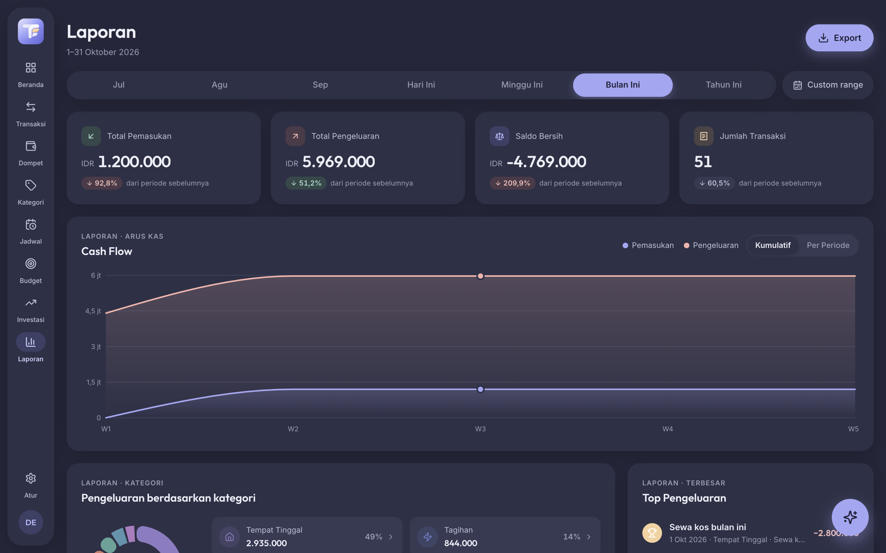<br/><b>Laporan</b> — ringkasan, cash flow, kategori, tren bulanan, export</td>
  </tr>
  <tr>
    <td>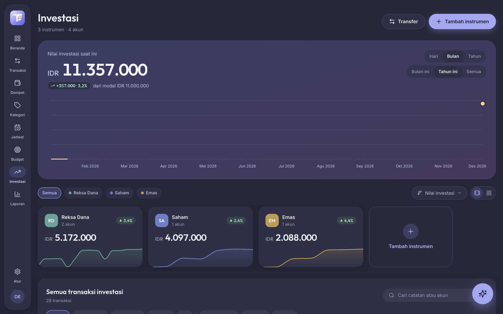<br/><b>Investasi</b> — nilai portofolio, P/L, per instrumen & akun</td>
    <td>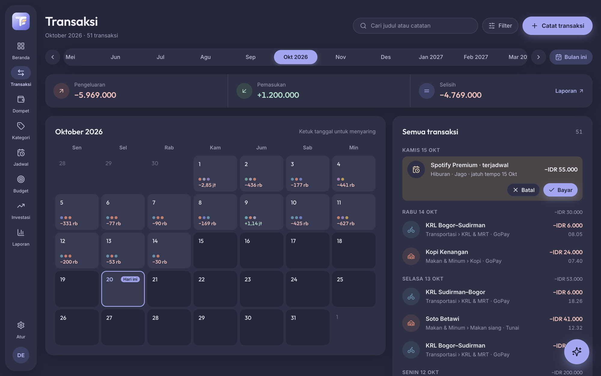<br/><b>Transaksi</b> — kalender bertitik, filter, cari, infinite scroll</td>
  </tr>
  <tr>
    <td>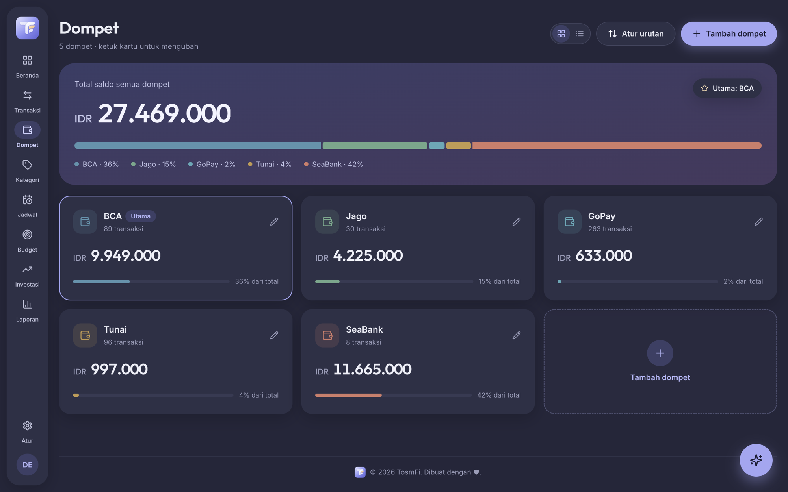<br/><b>Dompet</b> — saldo, porsi, tampilan grid/list, atur urutan</td>
    <td>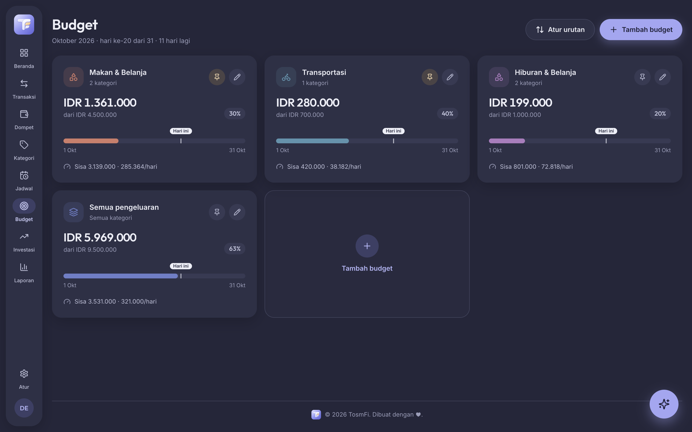<br/><b>Budget</b> — limit bulanan per kategori, sisa per hari</td>
  </tr>
  <tr>
    <td>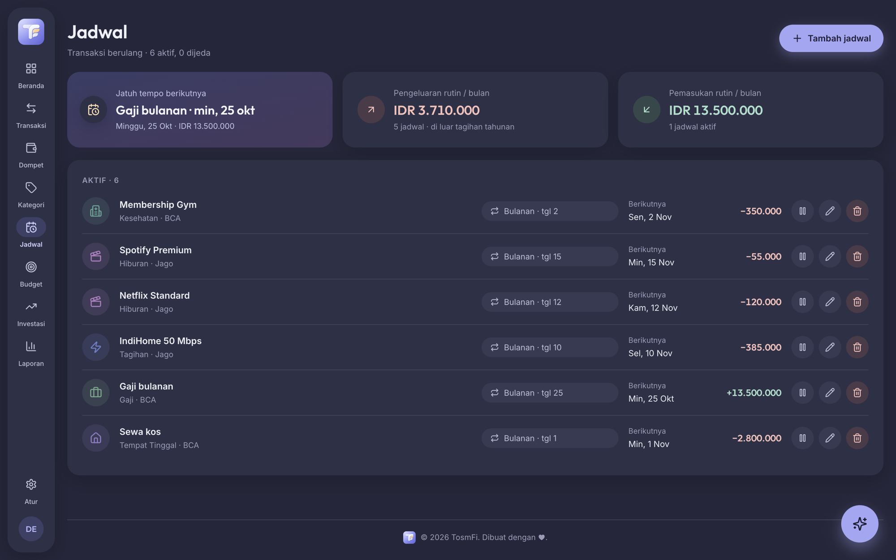<br/><b>Jadwal</b> — tagihan & pemasukan rutin</td>
    <td>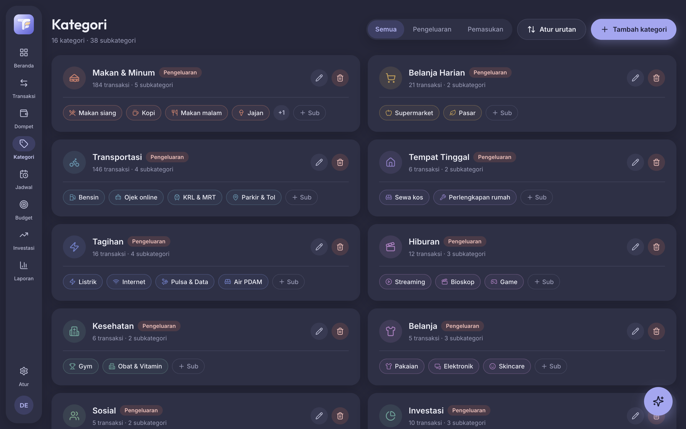<br/><b>Kategori</b> — kategori & subkategori dengan ikon dan warna</td>
  </tr>
  <tr>
    <td>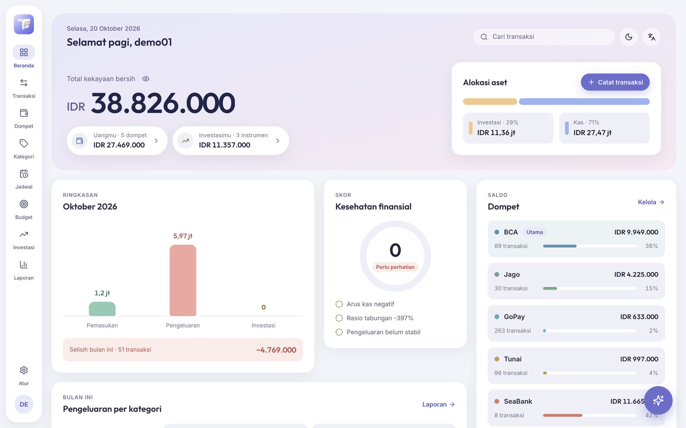<br/><b>Tema terang</b> — Terang / Gelap / Ikuti sistem</td>
    <td>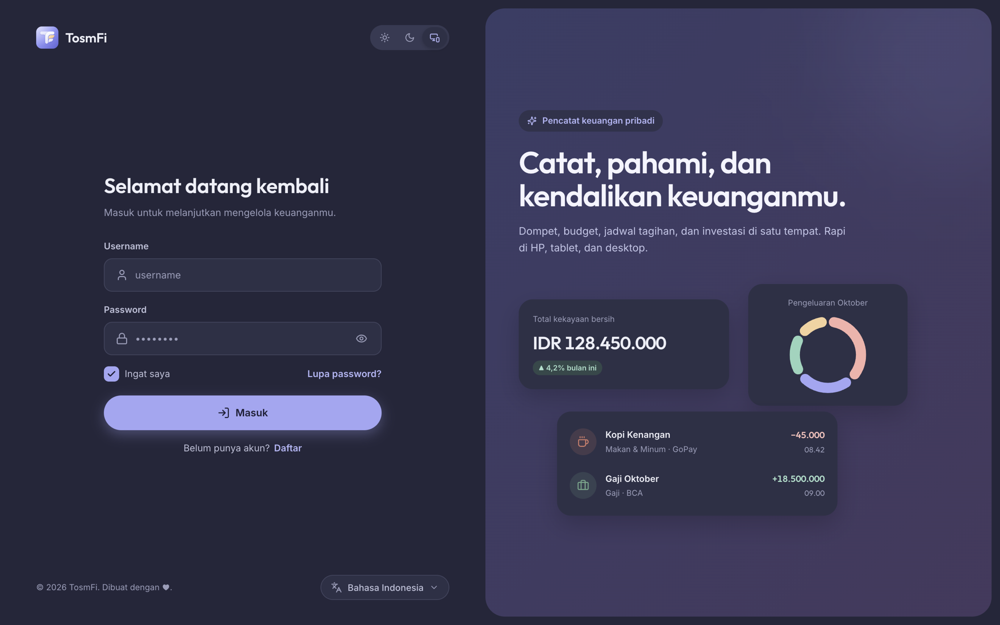<br/><b>Login</b> — dengan pilihan bahasa ID / EN / JP</td>
  </tr>
</table>

<details>
<summary><b>Tampilan HP (responsif / PWA)</b></summary>
<br/>
<p align="center">
  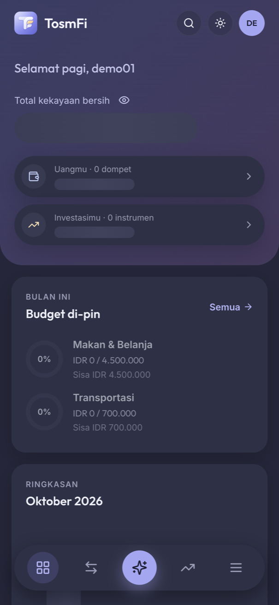
  &nbsp;&nbsp;
  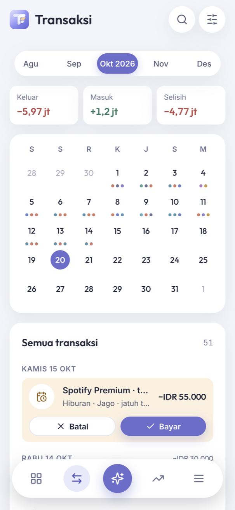
</p>
</details>

## ✨ Fitur

- **Dashboard** — total kekayaan bersih (kas + investasi), alokasi aset, ringkasan bulan, skor kesehatan finansial, pengeluaran per kategori (donut + drill-down), dompet, dan transaksi bulan ini.
- **Transaksi** — pemasukan, pengeluaran, transfer antar dompet, dan koreksi saldo; kalkulator `+ − × ÷` di input nominal; filter dompet/tipe/kategori/tanggal, pencarian, dan kalender.
- **Dompet & Kategori** — warna custom, dompet utama, subkategori, drag-to-reorder.
- **Budget** — limit bulanan untuk semua pengeluaran atau per kategori/subkategori, bisa di-pin ke dashboard.
- **Jadwal** — transaksi berulang (harian/mingguan/bulanan/tahunan) dengan tombol Bayar / Batal per jatuh tempo.
- **Investasi** — instrumen (reksa dana, saham, emas, dll.) dengan beberapa akun, setor/tarik/transfer/update nilai, entri bertanggal mundur, grafik nilai vs modal.
- **Laporan** — periode hari/minggu/bulan/tahun/custom, perbandingan dengan periode lalu, cash flow, tren 12 bulan, top pengeluaran, dompet paling aktif. **Export PDF / Excel / CSV.**
- **Catat Cepat (AI)** — lihat bagian di bawah.
- **Multi-bahasa** (Indonesia, English, 日本語), **multi-mata uang** (IDR/USD/JPY), **tema terang/gelap**, **PWA** (bisa di-install).
- **Admin** — persetujuan pengguna baru dan log error dari klien.

## 🤖 Catat Cepat — pencatatan dengan AI (LLM)

Tulis transaksi seperti chat biasa, misalnya *"hari ini makan warteg 25rb sama kopi 18rb pakai gopay"*. AI akan:

1. Memecahnya menjadi beberapa **draft transaksi** (judul, nominal, kategori/subkategori, dompet, tanggal).
2. **Bertanya** kalau ada yang kurang (tanggal, dompet, akun investasi), lengkap dengan tombol jawaban cepat.
3. Menampilkan **pratinjau** yang bisa direvisi lewat chat (perubahan ditandai `lama → baru`).
4. **Menyimpan** hanya setelah dikonfirmasi (tombol Simpan atau ketik "catat"), semua draft dalam satu batch atomik.

Bisa mencatat semua jenis input: pemasukan, pengeluaran, transfer, koreksi saldo, serta setor/tarik/transfer/update nilai investasi. Chip **"Contoh, tinggal tap"** diambil dari transaksi yang sering berulang dalam 30 hari terakhir.

| | |
|---|---|
| **Model** | Google **Gemini** (`gemini-3.8-flash`, dengan fallback ke model Flash/Flash-Lite lain) |
| **Akses** | Lewat backend [`tosm-fi-be`](https://github.com/riantosm/tosm-fi-be) (`POST /assistant/chat`, `POST /assistant/commit`), API key tidak pernah sampai ke browser |
| **Output** | JSON terstruktur (`response_format: json_schema` strict), lalu divalidasi ulang di server terhadap data user |

Detail cara kerja LLM (hedging, fallback, aturan validasi) ada di [README backend](https://github.com/riantosm/tosm-fi-be#-ai--llm).

## 🛠️ Tech stack

| Kategori | Teknologi |
|---|---|
| Framework | React 19, TypeScript 6, Vite 8 |
| Styling | Tailwind CSS 4 (token di `@theme`, dark mode via class), font Inter & Outfit |
| State | Redux Toolkit + redux-persist |
| Routing | React Router 7 |
| HTTP | Axios (interceptor JWT + auto-logout saat 401) |
| Grafik | Recharts |
| Animasi | Motion |
| i18n | i18next + react-i18next (ID / EN / JP) |
| Export | jsPDF + jspdf-autotable (PDF), SheetJS `xlsx` (Excel/CSV) |
| Ikon | react-icons |
| PWA | vite-plugin-pwa (auto-update, manifest, ikon maskable) |
| Lint/format | ESLint 10, Prettier |
| Hosting | Netlify (SPA redirect di `netlify.toml`) |

## 🏗️ Arsitektur singkat

```
src/
├── app/            # AppRouter, ProtectedRoute, ErrorBoundary, pages/*Page (tipis)
├── layouts/        # komponen per fitur (transaction, wallet, assistant, report, …)
├── components/     # atomic design: atoms / molecules / organisms / templates
├── hooks/          # use-<entity>: menggabungkan service + Redux slice
├── services/       # pemanggilan API (http-client axios)
├── redux/          # slices + store (persist)
├── types/          # tipe entitas + Input
├── helpers/lang/   # id.json, en.json, jp.json
├── utils/          # report period, export, assistant examples, crash logger, …
├── constants/      # routes, api-docs (spesifikasi endpoint), storage keys
└── css/            # Tailwind v4 @theme + token Mist
```

Setiap fitur yang punya data mengikuti pola **Type → Service → Redux slice → Hook → entri API doc**. Komponen tidak pernah memanggil service atau slice langsung. Dokumentasi endpoint lengkap bisa dilihat di aplikasi: **Pengaturan → Backend API**. Penjelasan detail ada di [`CLAUDE.md`](CLAUDE.md), dan sistem desain "Mist" di [`DESIGN_SYSTEM.md`](DESIGN_SYSTEM.md).

## 🚀 Menjalankan secara lokal

Prasyarat: Node.js 20+ dan Yarn/npm. Backend bisa memakai versi produksi atau [`tosm-fi-be`](https://github.com/riantosm/tosm-fi-be) yang dijalankan lokal.

```bash
git clone https://github.com/riantosm/tosm-fi.git
cd tosm-fi
yarn install
cp .env.example .env
yarn dev            # http://localhost:5173
```

| Variabel | Contoh | Keterangan |
|---|---|---|
| `VITE_API_BASE_URL` | `http://localhost:3000/api` | Base URL backend. Pakai `https://tosm-fi-be.vercel.app/api` untuk backend produksi. |

| Script | Fungsi |
|---|---|
| `yarn dev` | Dev server Vite (port 5173 atau `$PORT`) |
| `yarn build` | Type-check (`tsc -b`) + build produksi ke `dist/` |
| `yarn preview` | Menjalankan hasil build |
| `yarn lint` | ESLint |

## 📄 Dokumen lain

- [`CLAUDE.md`](CLAUDE.md) — arsitektur & konvensi kode
- [`DESIGN_SYSTEM.md`](DESIGN_SYSTEM.md) — token, komponen, dan pola halaman "Mist"
- [`INVESTMENT_NOTE_FEATURE.md`](INVESTMENT_NOTE_FEATURE.md) — catatan fitur investasi

---

<div align="center">
<sub>© 2026 TosmFi · Web · <a href="https://github.com/riantosm/tosm-fi-app">Mobile</a> · <a href="https://github.com/riantosm/tosm-fi-be">Backend</a></sub>
</div>
